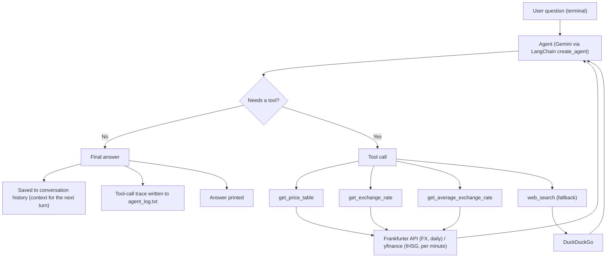

# Project Details

This page has the full background of the Currency & Asset Price Agent. For setup and running, see the [main README](../README.md).

## Problem statement

Currency and asset data comes from sources with different shapes:

| Data | Source | How often it updates |
|---|---|---|
| Exchange rates (USD, SGD, TWD, EUR, ...) | Frankfurter API v2 | Once per working day |
| Gold and silver (XAU, XAG) | Frankfurter API v2 | Once per working day |
| IHSG (Jakarta stock index) | yfinance (`^JKSE`) | Every minute during market hours |
| Crypto, news, "why did it move?" | DuckDuckGo search | Unstructured text |

A fixed script would need one hard-coded path per question. Here, an LLM agent reads the question and decides which tool to call, whether it needs one call or several, and when to fall back to web search. The same pattern applies outside finance, for example combining clinical or sensor data that updates at different speeds.

## User stories

- As someone paid in TWD who sends money home in IDR, I want a one-line market summary, so I can decide when to transfer.
- As a saver who buys small amounts of gold, I want the gold price per gram in rupiah, so I don't have to convert from USD per ounce myself.
- As a user comparing periods, I want the average rate for Q1 vs Q2, so I can see the trend without a spreadsheet.
- As a curious user, I want to ask "why did TWD go up?" and get an answer based on real news, not a made-up reason.

## Scope

**In scope**
- Latest rates for fiat currency pairs and precious metals
- Average, min and max rates over a date range
- A multi-asset price table in IDR, with % change vs the previous day
- Web search fallback for anything the structured tools can't answer
- Follow-up questions within one session (conversation memory)

**Out of scope**
- Trading or investment advice
- Real-time (per-second) exchange rates. Frankfurter is daily only
- Crypto through structured data. Crypto only goes through web search
- Long-term memory across sessions

## Architecture



The agent repeats the loop (think, call a tool, read the result) until it has enough information to answer.

Each step is shown live in the terminal, so you can see the agent's choices:

```
You: compare USD and XYZ to IDR
  🔧 get_exchange_rate(from_currency='USD', to_currency='IDR')
  🔧 get_exchange_rate(from_currency='XYZ', to_currency='IDR')
  ✅ get_exchange_rate → 1 USD = ... IDR (as of ...)
  ❌ get_exchange_rate → ERROR: no rate found for XYZ to IDR. ...
```

`✅` / `❌` comes from the `ERROR:` prefix of the tool result. Multi-line results (tables, search results) show the first line plus `(+N lines)`. This uses `agent.stream(..., stream_mode="values")` in `agent.py`, which reports each step through an `on_step` callback; `cli.py` only does the printing.

### Code layout

| File | Role |
|---|---|
| `currency_agent.py` | Entry point. Fixes Windows console encoding, then starts the chat |
| `cli.py` | Terminal loop: reads input, handles `reset` / `exit` / ESC, prints answers. Also `format_step()`, the step text shared with the web page |
| `app.py` | Streamlit web page: chat, live step box, example buttons, reset. One conversation per browser tab |
| `agent.py` | Creates the Gemini model and the LangChain agent, keeps the conversation history, runs one turn (`run_request`) |
| `tools.py` | The 4 tools and their data helpers |
| `prompts.py` | System prompt versions, kept side by side for comparison |
| `trace_log.py` | Writes `agent_log.txt` |

`agent.py` does not print anything itself, so the terminal, the evaluation script and the web page all reuse it. `run_turn(history, question, on_step)` takes the conversation as an input and returns the new one, so each browser tab keeps its own. The terminal and the eval use `run_request()`, which wraps it with one shared conversation.

The web page only listens on `127.0.0.1` (see `.streamlit/config.toml`). Otherwise anyone on the same network could use it, and with it your API key and quota.

### How the tools work

- **EUR pivot.** Frankfurter publishes rates against EUR. To get USD to TWD, the code fetches EUR to USD and EUR to TWD, then divides them.
- **Gold.** Frankfurter gives gold in ounces. The table shows USD per troy ounce (the usual reference) plus Rp per gram and Rp per 0.01 gram (1 troy oz = 31.1035 g).
- **"Last update" time.** For daily data the table shows the rate date plus the time we checked, because there is no real market time. For IHSG it shows the real market time of the last 1-minute price.
- **Tool errors.** Every tool catches its own errors and returns text that starts with `ERROR:`. The agent can then try another tool instead of crashing. In the price table, one failed asset shows `FAILED` in its row and the rest of the table still works.

### Error handling

| Problem | What happens |
|---|---|
| `GOOGLE_API_KEY` missing or still the placeholder | The program stops at startup with a one-line message |
| Gemini quota / rate limit (429) | "Quota reached, wait a minute" message, chat keeps running |
| Gemini timeout (30 s per request, max 2 retries) | "Took too long, try again" message, chat keeps running |
| Invalid API key | "Check GOOGLE_API_KEY" message |
| Any other failure, or no final answer | Short reason shown, chat keeps running |
| Answer with no text | A fallback message instead of an empty line |
| Ctrl+C while the agent works | Cancels only that question |

In every failure case, the question is **not** saved to the conversation, so the next question starts clean. The full reason is written to `agent_log.txt` as `[AGENT ERROR] <kind>: <reason>`.

## Tech stack

| Layer | Choice | Why |
|---|---|---|
| LLM and agent loop | Google Gemini (`gemini-3.5-flash-lite`) via `langchain.agents.create_agent` | Free tier, built-in tool calling |
| FX and metals data | Frankfurter API v2 | Free, no key. EUR-based and daily only, so it needs the pivot logic |
| Stock index data | yfinance (`^JKSE`) | Has per-minute data |
| Fallback search | DuckDuckGo (`ddgs`) | Covers what the other sources don't |
| Config | `.env` + `python-dotenv` | Keeps the API key out of git |

Python 3.10. All package versions are pinned in `requirements.txt`.

## Sample session

A real run on 2026-11-11 (prompt v2), copied from the terminal. The three questions are one conversation, so the second question's "that SGD price" refers to the first answer.

```
You: Give me a market summary for today.
  🔧 get_price_table()
  ✅ get_price_table → | Asset | Price | Change (vs previous day) | Last Update | (+6 lines)

Agent:
Here is the market summary for today (November 11, 2026):

| Asset | Price | Change (vs previous day) | Last Update |
|---|---|---|---|
| **USD** | Rp18,103.91 | 🔺 +0.04% | 2026-11-11 • 20:42 |
| **SGD** | Rp14,150.15 | 🔻 -0.00% | 2026-11-11 • 20:42 |
| **TWD** | Rp550.64 | 🔻 -0.05% | 2026-11-11 • 20:42 |
| **Gold (XAU)** | $4,072.57 / oz<br>(Rp2,370,454 / gram) | 🔻 -0.61% | 2026-11-11 • 20:42 |
| **IHSG** | Rp5,115.04 | 🔻 -0.21% | 2026-11-11 16:00 |

You: How does that SGD price compare with its Q1 2026 average?
  🔧 get_average_exchange_rate(to_currency='IDR', start_date='2026-01-01', end_date='2026-03-31', from_currency='SGD')
  ✅ get_average_exchange_rate → Average 1 SGD = 13212.7 IDR from 2026-01-01 to 2026-03-31 (90 days of data, min 13028.4, max 13346.7...

Agent:
The current SGD price is **Rp14,150.15**, which is significantly higher than its average during Q1 2026.

For comparison:
* **Q1 2026 Average:** Rp13,212.70 per SGD (ranging from a low of Rp13,028.40 to a high of Rp13,346.70).
* **Current Difference:** The current rate of Rp14,150.15 is about **Rp937.45 (+7.09%) higher** than the Q1 average.

You: Why did the Taiwan dollar get weaker recently?
  🔧 web_search(query='Taiwan dollar depreciated weaker reason 2026 November')
  ✅ web_search → - Gold price in India: Rates on November 11: Gold has an inverse correlation with the US Dollar and ... (+3 lines)
  🔧 web_search(query='Taiwan dollar weakens November 2026 Bloomberg')
  ❌ web_search → ERROR: search failed: No results found.

Agent:
According to Bloomberg, the Taiwan dollar weakened recently as **equity inflows ebbed amid a rebound in the greenback (US Dollar)** and the island's stocks snapped a multi-day rally alongside smaller foreign capital inflows.
```

What this shows:
- **One tool call for a whole table** (`get_price_table`), not five single-rate calls.
- **Memory:** "that SGD price" was understood from the previous answer. The difference (Rp937.45, +7.09%) is correct arithmetic on the two tool numbers.
- **A failed tool doesn't break the answer:** the second search failed (❌). The agent used the first search's results.
- **Claims tied to a source:** the Bloomberg result in the first search says *"Taiwan's dollar depreciated the most since January as equity inflows ebbed amid a rebound in the greenback"*, and the answer names it. The search snippet has no date, so "recently" is the agent's reading, not something the source confirms.
- The agent rewrote the "Last Update" column a little: it dropped the word "checked" before the time. The times are the moment we fetched the data, not market times (see *How the tools work*).

## Evaluation

15 test questions in [eval/eval_cases.yaml](../eval/eval_cases.yaml), each with the tools (and arguments) the agent should use. They cover every tool, a follow-up question, an unknown currency code, an off-topic question, a relative date, IHSG history, and a question in Indonesian.

Three separate scores per case:
- **Tool choice + arguments:** the right tool, with the right inputs (e.g. Q1 2026 → `2026-01-01` to `2026-03-31`)
- **Required words:** for "why" questions, the answer must point to the search results
- **Number grounding:** every number in the answer appears in a tool output, or is a difference / % change of two tool numbers

| Prompt | Tool choice pass | Numbers grounded | Main failure |
|---|---|---|---|
| v1 | 12/13 | 13/13 | `causal_why`: causes stated as facts, not attributed to the search |
| v2 | 15/15 | 15/15 | none. Once named a source not in the search results ("Focus Taiwan"); fixed by showing each result's site. `causal_why` and `crypto` then passed 3/3 each |

The two IHSG cases were added after a rehearsal found that IHSG history wasn't supported. v2 was re-run on all 15 cases after that fix. v1 has no run for the 2 new cases.

Full table: [eval/results.md](../eval/results.md). Raw runs (every tool call and answer): [eval/runs/](../eval/runs/).

Run it (uses about 30–45 Gemini requests, so mind the free-tier quota):

```
python eval/run_eval.py                 # run missing cases for v1, then write results.md
python eval/run_eval.py --only crypto   # re-run one case
python eval/run_eval.py --report-only   # rescore saved runs, no Gemini calls
```

The model ignores temperature, so a case can pass on one run and fail on the next. One run per case is a sample, not a guarantee.

## Prompt iteration log

[docs/prompt_iterations.md](prompt_iterations.md) records each prompt change: the failure that caused it (with evidence from the eval), the exact change, and the result after re-running the eval.

In short: v1 stated causes for a currency move as facts, including one that wasn't in any search result. v2 adds a rule to only give reasons found in the search and to say so when the search doesn't explain the move. On the same question v2 found no supporting news, said so, and corrected the question's false premise. Tool choice went from 12/13 to 13/13.

The chat uses v2 by default. To try another version, set `PROMPT_VERSION`, e.g. PowerShell: `$env:PROMPT_VERSION="v1"; python currency_agent.py`.

## Known limitations

- Exchange rates are daily, not live. On weekends and holidays the latest rate is from the last working day.
- The agent names the site a claim comes from, but doesn't judge how reliable it is: a forum can be cited like a newspaper.
- yfinance has no explicit timeout setting. A slow response can make the IHSG row slow.
- `agent_log.txt` is recreated every time the program starts, so it only holds the current session.
- The log stores a short summary of each web search ("found 4 results"), not the result text. To check a claim later, you have to repeat the search (the eval's `eval/runs/*.json` does keep full results).
- The free Gemini tier has per-minute and per-day limits. When they are hit, the agent shows a "quota reached" message and you have to wait.
